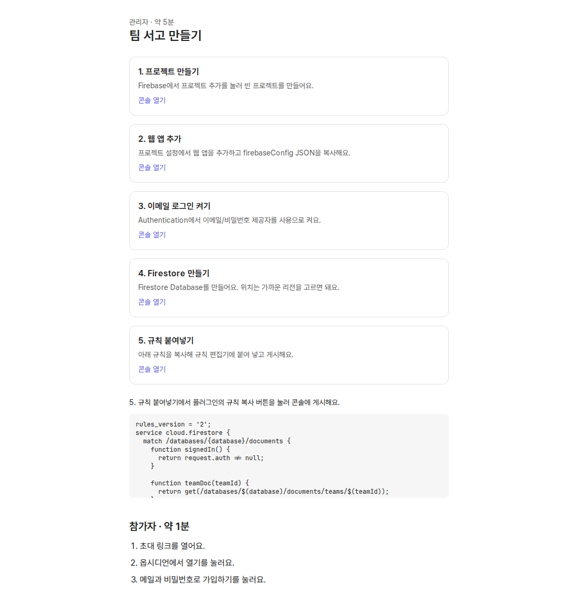
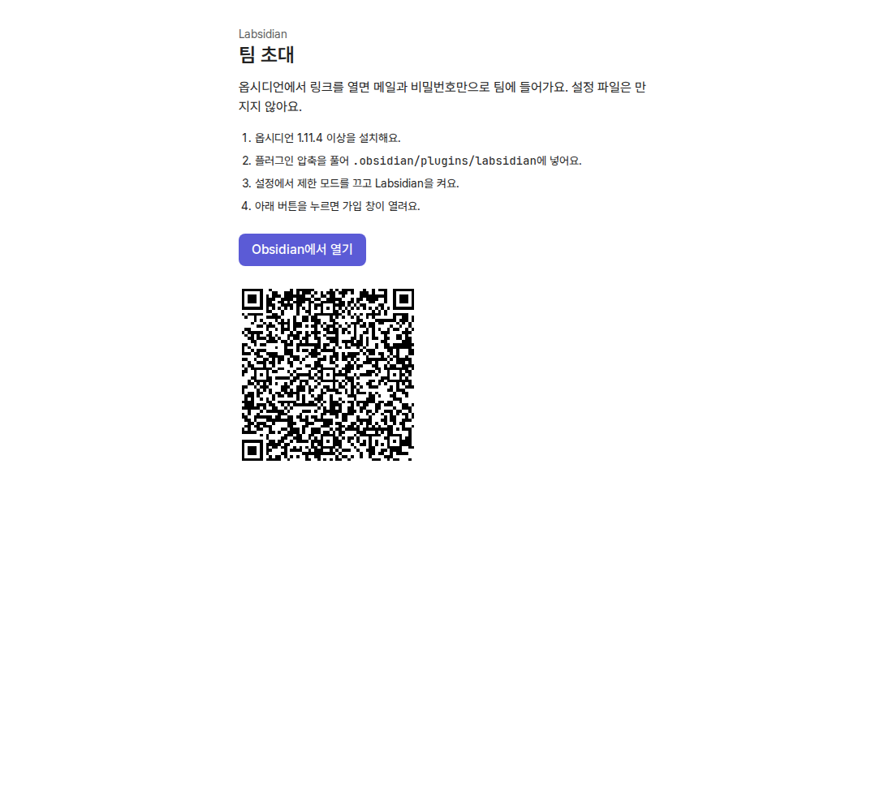

# Labsidian

옵시디언에서 키워드 하나로 영화진흥위원회, 한국콘텐츠진흥원, OpenAlex를 검색하고, PDF 본문을 마크다운 노트로 저장하는 플러그인입니다. KCI와 RISS는 키를 넣기 전에는 꺼져 있습니다. 팀 서고와 주간 브리핑은 선택입니다.

라이선스는 MIT입니다. PDF 변환은 [kordoc 4.24.80](https://github.com/chrisryugj/kordoc) (MIT)과 pdfjs-dist (Apache-2.0)를 `main.js` 안에 넣어서, 윈도우에 Node나 Python을 설치하지 않아도 됩니다.

## 윈도우에 설치

1. 옵시디언 1.11.4 이상을 설치합니다.
2. 릴리스의 `labsidian-*.zip`을 풀어 `main.js`, `manifest.json`, `styles.css`를 볼트의 `.obsidian/plugins/labsidian` 폴더에 넣습니다.
3. 설정 → 커뮤니티 플러그인에서 제한 모드를 끄고 Labsidian을 켭니다.
4. 명령 팔레트에서 `자료 검색`을 실행합니다. 단축키는 Ctrl+Shift+L 또는 Cmd+Shift+L 입니다.

한컴오피스, Node, Python은 필요 없습니다. 원본 PDF는 볼트에 저장하지 않고, 변환한 노트와 원문 링크만 남깁니다.

## KCI 키

KCI는 키가 없으면 **키 필요**로 남고, 다른 출처 검색은 그대로 됩니다.

1. [KCI](https://www.kci.go.kr)에 가입합니다.
2. Open API 인증키 신청 화면에서 키를 신청합니다. 문의는 kciadmin@nrf.re.kr, 042-869-6674 입니다.
3. 플러그인 설정 → 출처에서 KCI 키를 저장하면 토글이 켜집니다.

RISS는 기관 키만 발급됩니다. 키가 없으면 **기관 키 필요**로 표시됩니다.

## 관리자, 약 5분

팀 서고 탭의 **팀 서고 만들기**가 같은 순서를 안내합니다. 각 단계의 **콘솔 열기**가 Firebase의 해당 화면으로 이동합니다.



1. 프로젝트를 만듭니다.
2. 웹 앱을 추가하고 설정 JSON을 복사합니다.
3. 이메일/비밀번호 로그인을 켭니다.
4. Firestore를 만듭니다.
5. **규칙 복사**를 눌러 규칙 편집기에 붙여 넣고 게시합니다.

그다음 JSON을 붙여 넣고 로그인합니다. JSON은 다시 화면에 보여 주지 않습니다. **초대 링크 만들기**를 누르면 `obsidian://labsidian-join?c=...&t=팀코드` 링크가 생깁니다. 팀코드의 해시만 `teams/{팀}`에 저장되고, 코드 원문은 설정 파일에 남지 않습니다.

브리핑을 올릴 때는 **브리핑 배포용 값 복사**를 눌러 아래 환경 변수에 넣습니다. 배포가 끝나면 그 주소를 브리핑 주소에 저장하면 초대 링크의 웹 페이지도 같이 만들어집니다.

[](https://vercel.com/new/clone?repository-url=https%3A%2F%2Fgithub.com%2Freallygood83%2Flabsidian&project-name=labsidian-briefing&root-directory=briefing&env=NEXT_PUBLIC_LABSIDIAN_CONFIG&envDescription=%ED%94%8C%EB%9F%AC%EA%B7%B8%EC%9D%B8%20%ED%8C%80%20%EC%84%9C%EA%B3%A0%20%ED%83%AD%EC%9D%98%20%EB%B8%8C%EB%A6%AC%ED%95%91%20%EB%B0%B0%ED%8F%AC%EC%9A%A9%20%EA%B0%92)

환경 변수는 `NEXT_PUBLIC_LABSIDIAN_CONFIG` 하나뿐입니다. 서비스 계정 키는 쓰지 않습니다. 브리핑 읽기는 공개이고, 노트 쓰기는 팀코드를 맞추고 가입한 멤버만 할 수 있습니다.

## 참가자, 약 1분

초대 링크를 열면 설치 안내, **Obsidian에서 열기**, QR이 나옵니다.



옵시디언이 설정을 채운 뒤 **가입하기 / 로그인** 창만 띄웁니다. 참가자는 JSON을 보지 않습니다. 메일과 비밀번호로 Firebase 이메일 가입을 하고, 링크에 들어 있던 팀코드로 `teams/{팀}/members/{uid}`에 들어갑니다. 코드가 없는 사람의 쓰기는 규칙이 거절합니다.

관리자는 팀 서고 탭에서 코드를 바꾸거나 멤버를 뺄 수 있습니다. 코드를 바꾸면 이전 초대 링크는 멈춥니다.

## 노트와 잠금

검색 결과에서 고른 항목마다 노트 하나가 생깁니다. 프론트매터 키는 `title`, `source`, `source_id`, `published`, `url`, `keywords`, `author`, `collected`를 포함합니다.

팀 서고에 올릴 때 비밀번호로 잠글 수 있습니다. 본문, 요약, 키워드는 Web Crypto(PBKDF2-SHA256 310,000회, AES-256-GCM)로 암호화되고, Firestore에는 암호문과 salt, iv, 반복 횟수만 올라갑니다. 비밀번호를 잊으면 복구할 수 없습니다. 비밀번호 변경과 잠금 해제는 본인 문서에서, 원래 비밀번호가 있어야 합니다.

## 개발

```bash
npm ci
npm test
npm run test:rules
npm run build
```

`npm test`는 출처 파서, 본문 정리, 초대 링크 파싱을 확인합니다. `npm run test:rules`는 Firestore 에뮬레이터와 `@firebase/rules-unit-testing`으로 팀코드 가입, 코드 없는 쓰기 거부, 공개 읽기를 확인합니다. 실서비스 Firebase는 쓰지 않습니다.

## 라이선스

MIT. Copyright (c) 2026 Moon Kim.
