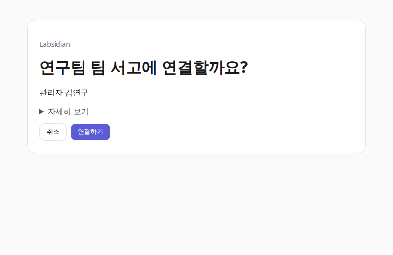
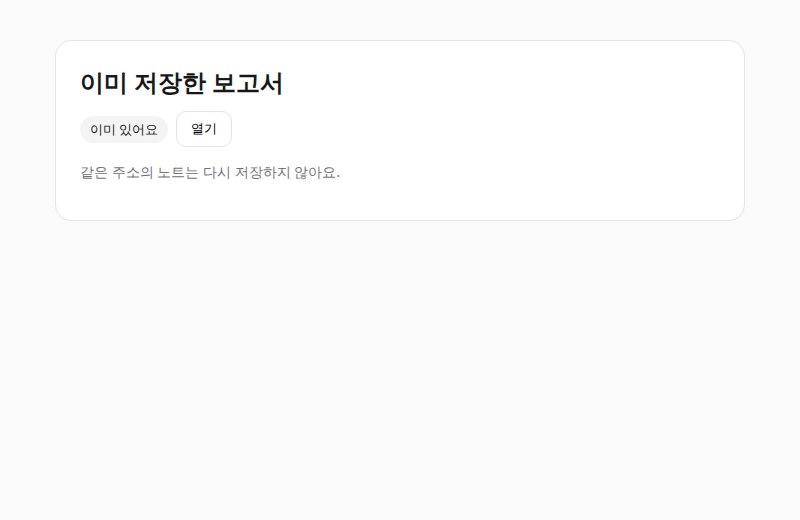
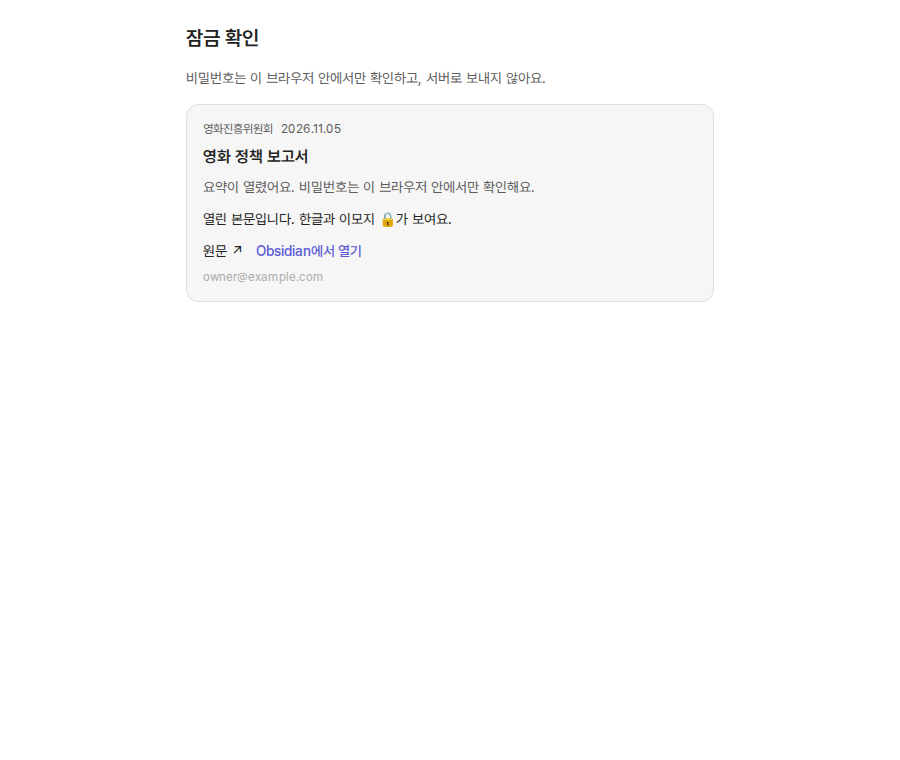

# Labsidian

옵시디언에서 키워드로 공개 연구자료를 찾아 마크다운 노트로 저장하는 플러그인입니다. KCI와 RISS는 키를 넣기 전에는 꺼져 있습니다.

라이선스는 MIT입니다. PDF 변환은 [kordoc 4.24.80](https://github.com/chrisryugj/kordoc) (MIT)과 pdfjs-dist (Apache-2.0)를 `main.js` 안에 넣습니다. 윈도우에 Node나 Python을 설치하지 않아도 됩니다.

## 세 가지 쓰는 법

설정 맨 위에서 고릅니다. 기본은 혼자 쓰기입니다.


- **혼자 쓰기.** 검색, PDF 변환, AI 요약, 노트 잠금이 내 볼트 안에서만 됩니다. 계정과 업로드는 없습니다.
- **내 클라우드.** 내 Firebase를 개인 서고로 연결합니다. 팀코드는 없습니다. 글은 기본적으로 나만 보고, 브리핑에 공개를 켠 글만 브리핑에 나옵니다.
- **팀으로 쓰기.** 관리자가 초대 링크를 만들고, 참가자는 그 링크로 가입합니다.

## 윈도우에 설치

1. 옵시디언 1.11.4 이상을 설치합니다.
2. 릴리스의 `main.js`, `manifest.json`, `styles.css`를 볼트의 `.obsidian/plugins/labsidian` 폴더에 넣습니다.
3. 설정 → 커뮤니티 플러그인에서 제한 모드를 끄고 Labsidian을 켭니다.
4. 명령 팔레트에서 `자료 검색`을 실행합니다. 에디터에서 고른 문장은 오른쪽 클릭의 `이 주제로 자료 찾기`로 검색합니다. 기본 단축키는 없습니다.

원본 PDF는 볼트에 저장하지 않고, 변환한 노트와 원문 링크만 남깁니다.

## 네트워크로 나가는 것

검색과 요약을 쓸 때만 아래 서버로 요청이 갑니다. PDF를 마크다운으로 바꾸는 일은 이 컴퓨터 안에서 합니다.

- 영화진흥위원회, 한국콘텐츠진흥원, OpenAlex로 검색어가 갑니다. KCI와 RISS는 키를 넣은 뒤에만 검색합니다.
- AI 요약을 켜면 고른 제공자(Gemini, OpenAI, Anthropic)로 요약할 글이 갑니다. 키는 옵시디언 비밀 저장소에 둡니다.
- 내 클라우드나 팀 서고에 올리면 그 Firebase 프로젝트로 노트 내용이 갑니다.
- 브리핑 사이트는 브라우저에서 Firestore를 읽습니다. 서비스 계정 키는 쓰지 않습니다.

## 누가 볼 수 있나

- 혼자 쓰기: 이 볼트를 연 사람만 봅니다.
- 내 클라우드: 올린 사람만 읽고 씁니다. 브리핑에 공개를 켠 글만 브리핑에서 보입니다.
- 팀: 팀코드를 맞추고 가입한 사람만 씁니다. 그 팀의 글은 브리핑에서 로그인 없이 볼 수 있습니다.

## 관리자, 약 5분

팀 서고를 만들 때만 필요합니다.


1. Firebase에서 프로젝트를 만듭니다.
2. 웹 앱을 추가하고 설정 JSON을 복사합니다.
3. 이메일/비밀번호 로그인을 켭니다.
4. Firestore를 만듭니다.
5. 로그인한 뒤 **규칙 복사**를 누릅니다. 복사된 규칙에는 내 계정만 관리자로 들어 있어요. 그 내용을 규칙 편집기에 붙여 넣고 게시합니다.

JSON을 붙여 넣고 로그인한 뒤 **초대 링크 만들기**를 누릅니다. 링크의 팀코드는 주소 끝 `#t=`에 있어서 웹 서버 기록에 남지 않습니다. 코드 원문은 설정 파일에 저장하지 않고, 해시만 `teams/{팀}`에 둡니다.

브리핑을 배포할 때는 **브리핑 배포용 값 복사**를 Vercel 환경 변수 `NEXT_PUBLIC_LABSIDIAN_CONFIG`에 넣습니다.

[](https://vercel.com/new/clone?repository-url=https%3A%2F%2Fgithub.com%2Freallygood83%2Flabsidian&project-name=labsidian-briefing&root-directory=briefing&env=NEXT_PUBLIC_LABSIDIAN_CONFIG&envDescription=%ED%94%8C%EB%9F%AC%EA%B7%B8%EC%9D%B8%20%ED%8C%80%20%EC%84%9C%EA%B3%A0%20%ED%83%AD%EC%9D%98%20%EB%B8%8C%EB%A6%AC%ED%95%91%20%EB%B0%B0%ED%8F%AC%EC%9A%A9%20%EA%B0%92)

## 참가자, 약 1분

초대 링크를 열면 설치 안내, **Obsidian에서 열기**, QR이 나옵니다.


옵시디언에서는 팀 이름과 관리자 이름을 확인한 뒤에만 연결합니다.



메일, 비밀번호, 표시 이름만 입력합니다. JSON은 보지 않습니다. 브리핑에는 메일이 아니라 표시 이름이 나옵니다.

## 검색과 저장

결과마다 초록 앞부분, 출처, 연도, PDF 있음이 보입니다. 고른 뒤 **선택한 n개 저장**을 누르면 `n/총개수`로 진행이 보이고, 실패한 항목은 건너뛴 뒤 마지막에 요약합니다.


볼트에 같은 source id, DOI, URL이 있으면 **이미 있어요**와 **열기**만 나오고 다시 저장하지 않습니다.



처음 실행하면 짧은 안내가 나옵니다. 건너뛸 수 있고, 설정에서 **안내 다시 보기**로 다시 켤 수 있습니다.


## 잠금

업로드할 때 **비밀번호로 잠그기**를 켜면 본문, 요약, 키워드와 함께 제목, 기관, 출처 식별자, 주소, PDF 주소, 저자, 검색어, 태그를 암호화합니다. 제목 숨기기는 기본으로 켜져 있고, 끄면 제목만 공개됩니다. 날짜와 표시 이름은 브리핑에 남을 수 있습니다. 메일 주소는 문서에 저장하지 않습니다.

암호화는 이 컴퓨터의 Web Crypto입니다. PBKDF2-SHA256(무작위 16바이트 salt, 310,000회 이상 2,000,000회 이하)으로 키를 만들고 AES-256-GCM으로 암호화합니다. 비밀번호와 평문은 Firestore, 로그, 설정 파일에 저장하지 않습니다. 비밀번호를 잊으면 아무도 열 수 없습니다. 브리핑에서 연 내용은 그 화면의 메모리에만 있고, 브라우저 저장소에는 남기지 않습니다.




## KCI 키

KCI는 키가 없으면 **키 필요**로 남고, 다른 출처 검색은 그대로 됩니다.

1. [KCI](https://www.kci.go.kr)에 가입합니다.
2. Open API 인증키 신청 화면에서 키를 신청합니다. 문의는 kciadmin@nrf.re.kr, 042-869-6674 입니다.
3. 플러그인 설정 → 출처에서 KCI 키를 저장하면 토글이 켜집니다.

RISS는 기관 키만 발급됩니다. 키가 없으면 **기관 키 필요**로 표시됩니다.

## 개발

```bash
npm ci
npm test
npm run test:rules
npm run build
```

`npm test`는 출처 파서, 본문 정리, 초대 링크, 잠금, 검색 사용성을 확인합니다. `npm run test:rules`는 Firestore 에뮬레이터에서 다른 계정의 읽기·쓰기 거부, 이메일 사칭 거부, 본인 삭제, 공개 글만 브리핑에 보이는지를 확인합니다. 실서비스 Firebase는 쓰지 않습니다.

릴리스 태그는 `v` 없이 `0.1.0`처럼 manifest 버전과 같아야 합니다. 첨부 파일은 `main.js`, `manifest.json`, `styles.css`입니다.

## 라이선스

MIT. Copyright (c) 2026 Moon Kim.
