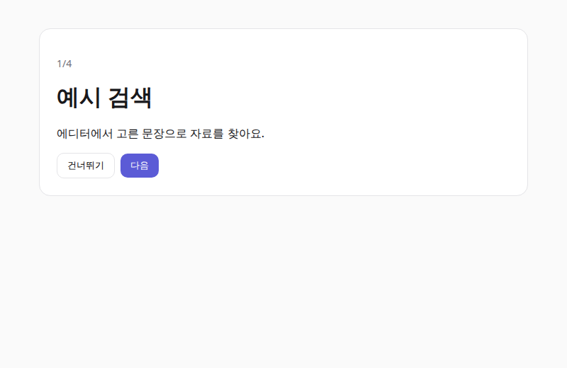
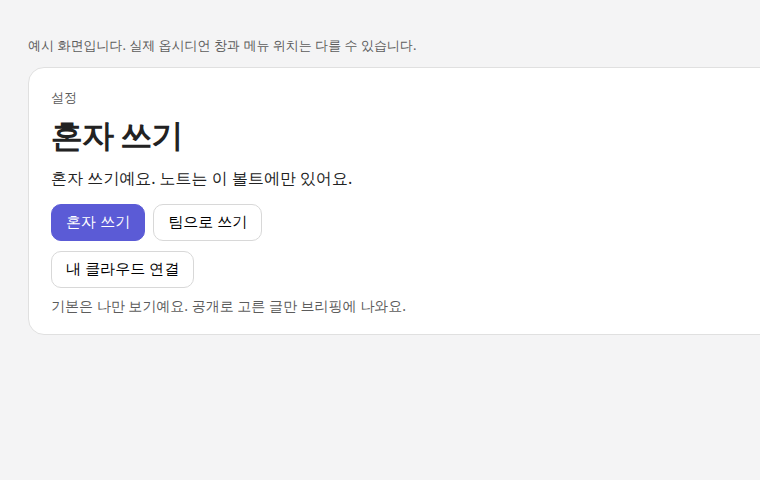

# 처음 시작

처음 켜면 짧은 안내 창이 나옵니다. 네 단계입니다.

1. **예시 검색** — 에디터에서 고른 문장으로 자료를 찾아요.
2. **미리보기** — 초록 앞부분, 출처, 연도, PDF 여부를 먼저 봐요.
3. **저장** — 고른 자료를 한 번에 노트로 저장해요.
4. **열기** — 저장된 노트를 바로 열어요. 이미 있는 자료는 다시 저장하지 않아요.

**다음**으로 넘기고, 마지막에는 **시작하기**가 있습니다. 지금 안 봐도 **건너뛰기**를 누르면 닫힙니다. 나중에 보려면 설정 → Research Shelf 맨 위의 **안내 다시 보기**를 누릅니다.

## 어떤 모드를 고르나

설정 → Research Shelf 맨 위에 지금 상태가 제목으로 나옵니다.

- **혼자 쓰기** — 기본값입니다. 검색, PDF를 노트로 바꾸기, AI 요약이 이 컴퓨터의 보관함 안에서만 됩니다. 계정과 업로드는 없습니다.
- **팀으로 쓰기** — 버튼을 누르면 모드만 바뀝니다. 실제로 연결되려면 [팀 서고](07-팀-서고.md)를 끝까지 해야 하고, 연결되면 제목이 **팀 서고에 연결됨**으로 바뀝니다.
- **내 클라우드 연결** — 내 Firebase를 개인 서고로 연결합니다. 연결되면 제목이 **내 클라우드에 연결됨**이 됩니다. 준비는 [개인 서고](06-개인-서고.md)에 있습니다.

처음이라면 **혼자 쓰기**로 충분합니다. 노트는 이 보관함에만 있습니다.

옆의 탭은 **출처**, **노트 양식**, **AI 요약**, **팀 서고**, **정보**입니다.

혼자 쓰기에서 바로 자료를 찾으려면 [자료 찾기와 저장](03-자료-찾기.md)으로 갑니다.
