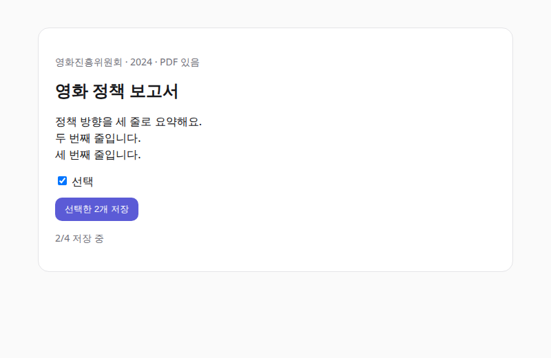
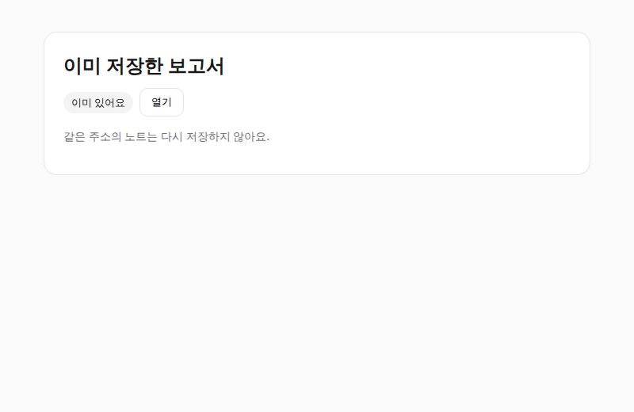

# 자료 찾기와 저장

## 검색을 여는 곳

기본 단축키는 없습니다.

- 명령 팔레트에서 **자료 검색**
- 왼쪽 리본의 **자료 검색** 아이콘
- 에디터에서 문장을 선택한 뒤 오른쪽 클릭의 **이 주제로 자료 찾기**
- 명령 팔레트의 **이 주제로 자료 찾기**도 선택한 문장으로 엽니다. 선택이 없으면 빈 검색이 열립니다.

검색칸 안내 문구는 **키워드를 입력해요**입니다. `Esc`로 닫습니다.

## 출처

위쪽 칩으로 출처를 켜고 끕니다. 설정 → **출처**의 **사용** 스위치와 같습니다.

| 화면 이름 | 특징 |
| --- | --- |
| 영화진흥위원회 | 정책연구 게시판을 제목으로 찾습니다. 첫 페이지만 가져옵니다. 키가 필요 없습니다. |
| 한국콘텐츠진흥원 | 연구보고서 게시판을 제목으로 찾습니다. 첨부가 여러 개면 저장 전에 고릅니다. 키가 필요 없습니다. |
| OpenAlex | 키 없이 검색됩니다. 키와 메일 주소가 없으면 **공유 한도 사용 중**으로 보일 수 있습니다. 키는 선택입니다. [openalex.org](https://openalex.org)에서 무료 키를 받을 수 있습니다. |
| KCI | 키가 없으면 칩에 **키 필요**가 붙고 검색하지 않습니다. 다른 출처는 그대로 됩니다. |
| RISS | 기관 키만 됩니다. 키가 없으면 **기관 키 필요**로 보이고 검색하지 않습니다. |

KCI 키를 받으려면 [KCI](https://www.kci.go.kr)에 가입한 뒤 Open API 인증키를 신청합니다. 문의는 kciadmin@nrf.re.kr, 042-869-6674 입니다. 받은 키는 설정 → **출처**의 KCI 칸에 넣습니다. **키 저장**이라는 별도 버튼은 없고, 칸에 넣으면 저장됩니다. 지울 때는 **키 지우기**입니다. 키는 이 기기의 비밀 저장소에만 있고, 노트 파일이나 이 저장소에 올리지 않습니다.

RISS Open API는 기관만 키를 받습니다. 개인 키는 없습니다. 없으면 그 출처만 꺼 둡니다.

각 출처의 **연결 확인**은 그 출처에 시험 요청을 보냅니다.

필터는 **연도**, **유형**, **PDF만**, **정렬**(관련도, 최신순, 오래된순)입니다.

## 미리보기와 여러 개 저장

결과에는 초록 앞부분, 출처, 날짜, PDF가 있으면 **PDF 있음**이 보입니다. 오른쪽 미리보기가 비어 있으면 **왼쪽에서 자료를 고르면 여기 나와요.**가 나옵니다. PDF가 있는 자료에는 **.md 변환 · 원본은 링크만**이 붙습니다.

칸을 체크하면 아래에 **n개 선택됨**과 **선택한 n개 저장**이 나옵니다. 키보드에서는 위아래 화살표로 이동하고, 스페이스로 선택합니다.



저장 중에는 **노트로 저장** 창이 열립니다. **창을 닫아도 계속 진행돼요.** 단계는 **받기**, **변환**, **요약**, **저장**입니다. 상태 줄에는 `labsidian 1/3`처럼 진행이 나옵니다. 끝나면 저장한 개수와, 이미 있던 개수, 실패한 개수를 따로 알려 줍니다. **노트 열기**, **취소**, **원문 페이지 열기**, **다시 시도**가 항목마다 있을 수 있습니다.

같은 출처 번호, DOI, 주소가 이미 있으면 **이미 있어요**와 **열기**만 나오고 다시 저장하지 않습니다.



## PDF는 노트로만 남음

원본 PDF 파일은 보관함에 저장하지 않습니다. 글이 마크다운 노트로 바뀌고, 노트 맨 아래 **원문**에 페이지 링크와 PDF 링크만 남습니다. 첨부가 여러 개면 **첨부가 여러 개예요. 노트로 만들 파일을 고르세요.**가 나옵니다.

## 노트가 생기는 곳

기본 폴더는 `연구자료`입니다. 설정 → **노트 양식**의 **노트 폴더**에서 바꿉니다.

파일 이름은 **파일 이름 규칙**입니다. 기본은 `{{series}} {{title}}`입니다. 쓸 수 있는 칸은 title, series, source, date, id, type입니다.

노트 맨 위의 정보 칸(프론트매터) 예시는 이렇습니다. 실제로 없는 값은 빠집니다.

```yaml
---
title: "한국 영화 정책의 변화"
source: "kofic"
source_id: "kofic-123"
url: "https://www.kofic.or.kr/example"
collected: "2026-11-16"
publisher: "영화진흥위원회"
author:
  - "김연구"
published: "2024-03-01"
pdf_url: "https://www.kofic.or.kr/example.pdf"
query: "영화 정책"
keywords:
  - "영화 정책"
tags:
  - research
  - kofic
---
```

클라우드에 올린 뒤에만 `doc_id`가 붙습니다. 그 값은 문서 번호이고, 브리핑에서 다시 열 때 같은 노트를 찾는 데 씁니다.

본문에 요약이 있으면 `> [!summary]- AI 요약` 호출이 들어갑니다.

다음: [AI 요약](04-AI-요약.md)
