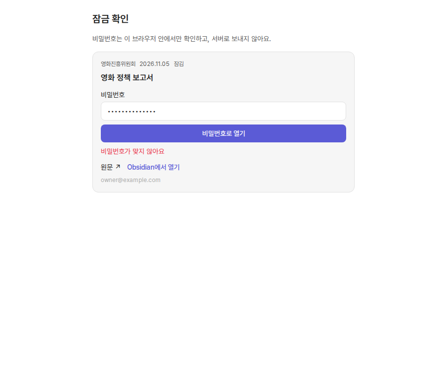
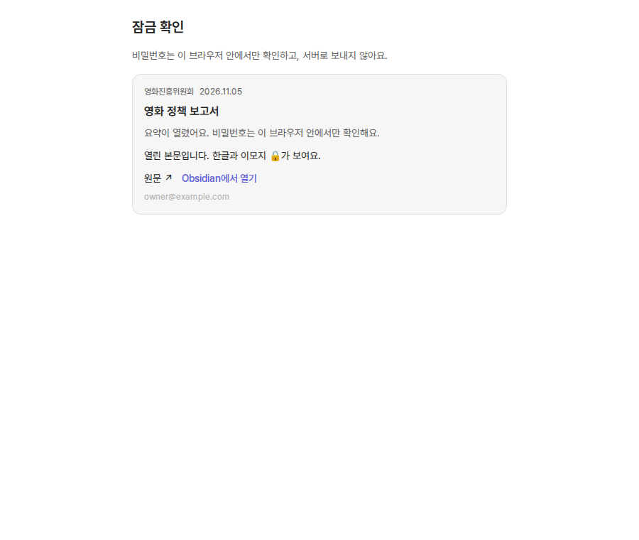

# 문서 잠금

잠금은 보관함에만 있는 노트에는 걸리지 않습니다. **내 클라우드**나 **팀 서고**에 올릴 때 비밀번호로 본문을 감쌉니다.

올리기 창 제목은 **노트 n개를 팀 서고에 올릴까요?**입니다. 명령 팔레트의 **이 노트를 팀 서고에 올리기**로 엽니다. 혼자 쓰기에서는 이 명령이 클라우드로 보내지 않고, 보관함에만 있다는 안내가 나옵니다.

## 걸기

올리기 창에서 **비밀번호로 잠그기**를 켭니다.

- 안내: **비밀번호를 잊으면 아무도 열 수 없어요.**
- **노트마다 다른 비밀번호**를 켜면 노트별로 넣습니다.
- **제목도 숨기기**는 잠그면 기본으로 켜집니다. 끄면 제목만 공개되고, 기관 이름은 잠긴 채입니다.
- 잠그면 본문, 요약, 키워드, 제목, 기관, 주소, 저자, 검색어, 태그가 암호로 바뀝니다. 시리즈, 출처 이름, 자료 유형, 날짜, 표시 이름은 평문으로 남을 수 있습니다. 메일 주소는 문서에 저장하지 않습니다.

비밀번호는 그 창에서만 쓰고 저장하지 않습니다. 서버에도 비밀번호를 보내지 않습니다. 이 컴퓨터에서 암호로 바꾼 뒤 암호문만 올라갑니다.

## 풀기와 바꾸기

브리핑이나 `obsidian://labsidian?id=문서번호` 링크로 잠긴 글을 열면 **이 자료는 비밀번호로 잠겨 있어요.**가 나옵니다. **열기**를 누르면 암호를 푼 글이 이 보관함에 노트로 저장됩니다. 화면에서만 잠깐 보이는 것이 아닙니다. 틀린 비밀번호는 **비밀번호가 맞지 않아요**입니다.

이미 올린 글의 비밀번호는 그 노트를 연 상태에서 명령 팔레트의 **팀 서고 잠금 바꾸기**입니다. 창 제목은 **잠금 비밀번호 바꾸기**입니다.

- **본인이 올린 문서만 바꿀 수 있어요. 지금 비밀번호가 있어야 하고, 잊으면 복구할 수 없어요.**
- **잠금 해제**는 지금 비밀번호로 암호를 풉니다.
- **비밀번호 바꾸기**는 새 비밀번호와 확인이 같아야 합니다.
- **제목도 숨기기**를 다시 고를 수 있습니다.

다른 사람이 올린 글이면 **본인이 올린 문서만 잠금을 바꿀 수 있어요.**가 나옵니다.

## 잊으면

비밀번호를 잊으면 아무도 열 수 없습니다. 관리자도, 이 플러그인도 복구하지 못합니다. 적어 두지 않은 비밀번호는 되찾지 못합니다.

다음: [개인 Firebase 서고](06-개인-서고.md)
