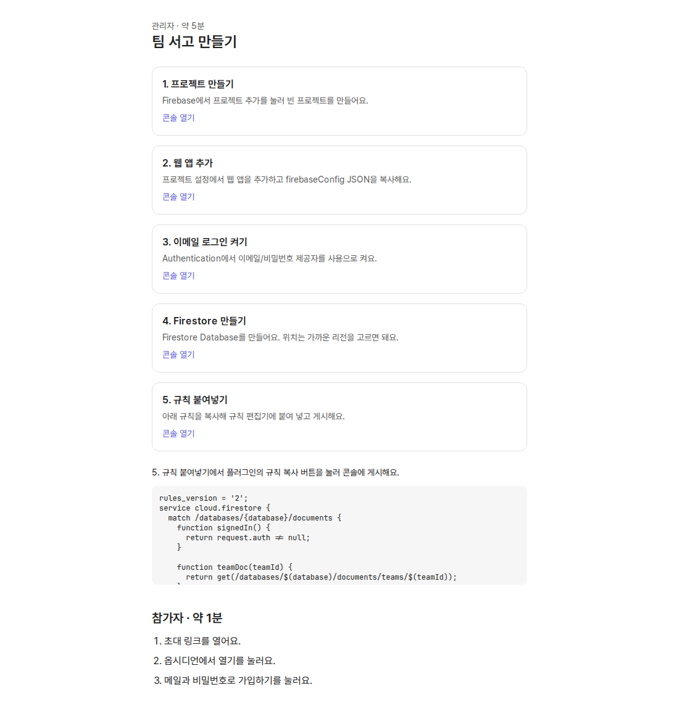

# 개인 Firebase 서고

혼자 쓰기로 충분하면 이 장은 건너뛰어도 됩니다. 내 클라우드에 노트를 두고, 내가 고른 글만 브리핑에 내려고 할 때 합니다.

Firebase는 구글의 데이터베이스 서비스입니다. 이 플러그인은 그 프로젝트의 웹 설정만 사용합니다. 서비스 계정 키(서버용 비밀 키)는 붙이지 않습니다.

설정 → **팀 서고**의 **팀 서고 만들기**에 같은 단계와 **콘솔 열기**가 있습니다.

## 1. 프로젝트 만들기

1. [Firebase 콘솔](https://console.firebase.google.com/)에서 프로젝트 추가를 누릅니다.
2. 빈 프로젝트를 만듭니다. 분석 도구는 꺼도 됩니다.

## 2. 웹 앱 설정

1. 프로젝트 설정에서 웹 앱을 추가합니다.
2. 나오는 `firebaseConfig`를 복사합니다. 주석이나 `import`가 위에 있어도, `const firebaseConfig = { ... }` 부분만 읽습니다. JSON으로 붙여도 됩니다. `apiKey`와 `projectId`가 있어야 합니다.
3. 플러그인 **팀 서고** 탭의 큰 입력칸에 붙여 넣고 **설정 확인**을 누릅니다.
4. 한 번 저장되면 **웹 설정이 저장되어 있어요. JSON은 다시 보여 주지 않아요.**가 나옵니다. JSON을 노트나 채팅에 다시 붙이지 않습니다.

## 3. 이메일 로그인

1. Authentication에서 이메일/비밀번호 제공자를 사용으로 켭니다.
2. Google 로그인을 쓰려면 Google 제공자도 켭니다. 플러그인 칸 이름은 **Google ID 토큰으로 로그인**입니다. 구글이 준 ID 토큰 문자열을 붙여 넣고 **로그인**을 누릅니다. 일반 구글 버튼은 없습니다.

## 4. Firestore

Firestore Database를 만듭니다. 위치는 가까운 지역을 고르면 됩니다. 테스트 모드로 오래 열어 두지 말고, 다음 단계의 규칙을 게시합니다.

## 5. 규칙

규칙은 “누가 이 서고를 만들고 글을 쓸 수 있는지”를 적는 문장입니다.

1. 이메일과 비밀번호를 입력하고 **계정 만들기**를 누릅니다.
2. 인증 메일이 갑니다. 메일의 링크를 누릅니다.
3. 플러그인에서 **로그인**을 다시 누릅니다. 인증 전에는 서고를 만들 수 없고, **메일 인증이 필요해요**가 나옵니다. **인증 메일 다시 보내기**로 메일을 다시 받을 수 있습니다.
4. 로그인한 뒤 **규칙 복사**를 누릅니다. 복사된 규칙에는 내 계정 번호만 관리자로 들어 있습니다.
5. Firestore 규칙 편집기에 붙여 넣고 게시합니다.

저장소의 `firestore.rules`에 있는 `__LABSIDIAN_ADMIN_UID__`를 그대로 게시하면 아무도 서고를 만들 수 없어 잠깁니다. 반드시 **규칙 복사**로 받은 글을 게시합니다.

## 6. 내 클라우드 연결

설정 맨 위의 **내 클라우드 연결**을 누릅니다. 성공하면 **내 클라우드에 연결했어요. 글은 기본적으로 나만 볼 수 있어요.**이고, 제목이 **내 클라우드에 연결됨**이 됩니다. 초대 링크는 여기서 만들지 않습니다. 개인 글을 팀에 맡기려면 먼저 **팀 서고로 옮기기**를 합니다. 그 전에 초대 링크를 만들려 하면 서버를 팀으로 바꾸지 않고, 먼저 옮기라고 안내합니다.

**브리핑에 공개**는 기본이 꺼져 있습니다. 켜면 **이 글을 올리면 인터넷에 공개돼요. 링크를 아는 사람이 볼 수 있어요.**를 확인해야 합니다. 안내 문구 **기본은 나만 보기예요. 공개로 고른 글만 브리핑에 나와요.**와 같습니다. 이 스위치는 다음 올리기 묶음 전체의 기본값입니다. 노트마다 따로 고르지는 않습니다.

올리기는 명령 **이 노트를 팀 서고에 올리기**입니다. 창의 **브리핑에 공개**는 그 번에 올리는 글 전체에 하나만 있습니다. **켜면 인터넷에 공개돼요. 링크를 아는 사람이 볼 수 있어요.**

다음: [팀 서고](07-팀-서고.md)
