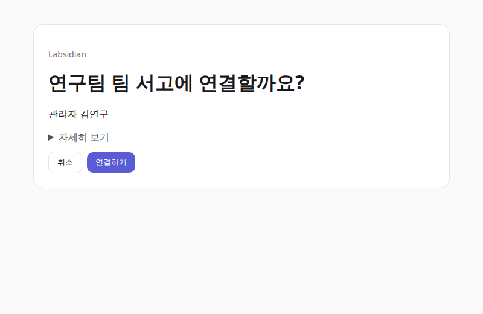
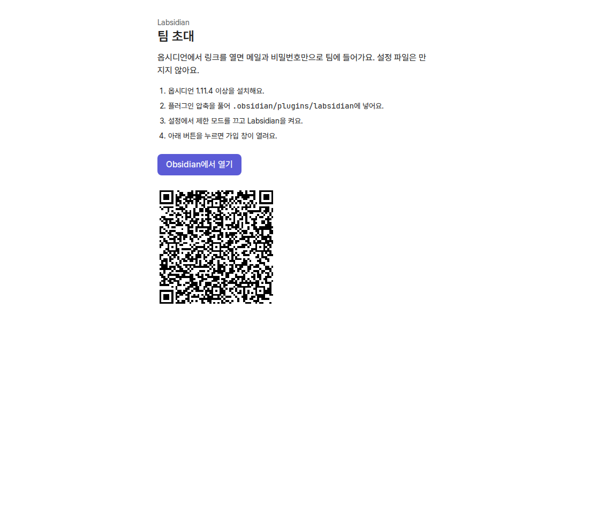

# 팀 서고

팀으로 쓰면 초대를 받은 사람만 글을 올릴 수 있습니다. 브리핑에 공개한 글은 로그인 없이 웹에서 볼 수 있습니다.

## 관리자

[개인 서고](06-개인-서고.md)의 1단계부터 5단계까지 같습니다. 이메일 인증을 끝내고 **로그인**한 뒤에만 서고를 만듭니다. 인증 전에 **초대 링크 만들기**를 누르면 메일 인증 안내가 나옵니다. 초대 링크를 다시 받으라는 문구는 이미 인증한 사람이 팀코드가 틀릴 때 나옵니다.

**팀 서고** 탭에서 다음을 입력합니다.

- **팀 이름** — 초대 화면에 나오는 이름입니다. 80자까지입니다.
- **표시 이름** — 브리핑에 나오는 내 이름입니다. 1자에서 80자이고, 메일 주소는 쓰지 않습니다. 팀에 가입한 뒤에는 이 칸이 잠깁니다. 글을 올릴 때는 칸의 글이 아니라 가입할 때 저장된 이름을 씁니다.

그다음 **초대 링크 만들기**를 누릅니다. 칸을 비우면 팀코드를 만들어 줍니다. 다른 기기에서 설정이 비어 있거나, 만들다 실패한 뒤 다시 눌러도 같은 서고를 이어서 코드를 새로 저장합니다. 이미 멤버이면 다시 가입하지 않습니다. 코드를 바꾸면 이전 링크는 멈춥니다. 코드 원문은 설정 파일에 저장하지 않고, 확인용 해시만 서버에 둡니다. 링크의 팀코드는 주소 끝 `#t=`에 있어서 웹 서버 기록에 남지 않습니다.

**초대 링크 복사**는 웹 초대 주소를 복사합니다. 웹 주소가 없으면 옵시디언 주소를 복사합니다.

**멤버 새로고침**으로 이름을 다시 불러옵니다. 목록에는 관리자 본인도 나옵니다. 아무도 없으면 **아직 다른 멤버가 없어요.**입니다. **멤버 빼기**를 누르면 그 사람을 내보내고 팀코드가 바뀝니다. 이전 초대는 멈춥니다. 남은 사람은 예전에 받은 코드가 달라도, 이미 멤버이면 로그인할 때 다시 가입을 시도하지 않습니다.

## 팀원

1. 관리자가 준 웹 초대 또는 옵시디언 초대를 엽니다. 웹 페이지에는 설치 안내, **Obsidian에서 열기**, QR이 있습니다. QR도 `#t=` 주소입니다.
2. 옵시디언에서 **OO 팀 서고에 연결할까요?**를 확인합니다. **지금 연결**과 **새로 연결**에 프로젝트 번호가 나옵니다. 프로젝트가 다르면 보관함의 클라우드 설정이 바뀐다고 경고합니다. 같은 프로젝트인데 팀이 다르면 지금 팀과 새 팀을 알려 줍니다.
3. **연결하기**를 누릅니다. JSON 파일은 만지지 않습니다.
4. **팀에 들어가기** 창에서 이메일, **표시 이름**, 비밀번호를 넣습니다. 이름은 1자에서 80자이고 메일 주소는 쓰지 않습니다.
5. **가입하기**는 계정만 만들고 인증 메일을 보냅니다. 이때는 아직 팀에 들어가지 않습니다. 화면은 **메일을 확인해 주세요. 받은 편지함의 링크를 누른 뒤 다시 로그인해 주세요.**입니다.
6. 메일의 링크를 누른 뒤 같은 창의 **로그인**을 누릅니다. 그때 팀에 들어갑니다.
7. 메일이 안 오면 **인증 메일 다시 보내기**를 누릅니다.

팀 서고 탭의 **로그인**도 같습니다. 팀코드가 저장되어 있고 메일이 인증되었으면 로그인하면서 팀에 들어갑니다. 인증 전에는 가입하지 않습니다.

## 개인 서고에서 팀으로 옮기기

**내 클라우드에 연결됨**일 때만 **팀 서고로 옮기기**가 보입니다. 확인 창은 **팀 서고로 옮기기**이고, **공개로 둔 글은 인터넷에 공개돼요. 비공개 글은 그대로 나만 봐요.**입니다.

옮길 때는 문서 번호와 본문은 그대로 두고 팀 번호만 바꿉니다. 다시 눌러도 같은 팀을 이어 가서 팀이 늘어나지 않습니다. 끝나면 초대 코드를 알려 줍니다.

이미 올린 글을 다시 올리면, 노트에 적힌 문서 번호를 먼저 씁니다. 다른 보관함에 잠긴 글을 다시 올리면 출처 번호가 암호 안에만 있어서 같은 글인지 찾지 못할 수 있습니다. 그때는 문서가 하나 더 생길 수 있습니다. 다른 사람이 올린 글을 내가 다시 올리면 그 사람의 문서 번호를 쓰지 않고 내 문서 번호를 새로 만듭니다.

## 인터넷에 공개될 수 있음

팀 모드에서 올리기 창의 **브리핑에 공개**는 기본으로 켜집니다. 그 번에 올리는 글 전체에 체크가 하나이고, **켜면 인터넷에 공개돼요. 링크를 아는 사람이 볼 수 있어요.** 공개하지 않으려면 체크를 끄고 올립니다. 끈 글은 브리핑에 나오지 않습니다.

다음: [Vercel 브리핑](08-브리핑.md)
